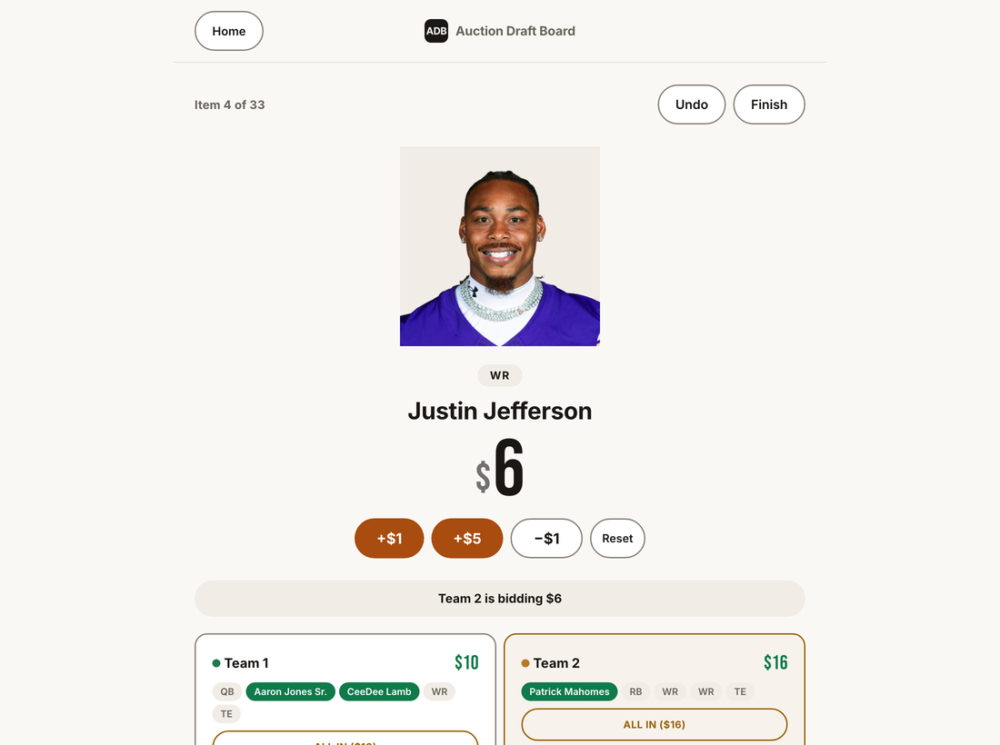

# Auction Draft Board

A live auction-draft board for game nights and creators: every team starts with the same budget, players are revealed
one at a time, teams bid out loud, and the board tracks budgets, roster slots and the bidding edge cases.

**Live demo:** https://mattthomas7641.github.io/auction-draft-board/



## Features

- **One host screen.** A phone or laptop shows the current player and every team's remaining budget. The host taps the
  leading team, bumps the bid (`+$1`, `+$5`, `−$1`, `Reset`) and presses **SOLD!** to lock it in.
- **Three built-in pools.** NBA, NFL and MLB players with headshots, each with matching roster slots
  (for example `PG, SG, SF, PF, C`). The pool is editable in Setup, one item per line as
  `Name | Category | Value (optional) | Photo URL (optional)`, so any category works without touching code.
- **Two draft modes.** *Open Auction*: anyone can pass on an item. *Must-Draft*: nothing is skipped; the team whose
  turn it is gets the item for $0 unless another team outbids them.
- **Bidding rules handled for you.**
  - A team can't win a bid it can't afford: **SOLD!** stays locked until the leading team can cover the bid.
  - **ALL IN** commits a team's whole remaining budget in one tap; another team can still outbid it.
  - Once a team hits $0, unwanted items go to a $0 team with an open slot, so every roster still fills.
  - Each player lands in a matching roster slot, or any open slot if none matches.
- **Undo and history.** **Undo** reverts the last action, an activity log records every sale, auto-draft and skip, and
  the browser's Back button steps through Results, Draft and Setup.
- **Results.** Final rosters and spend side by side, an automatic score when items have point values, and a one-tap
  winner declaration.

## Run locally

It is a static web app with no build step, no backend and no dependencies.

```bash
git clone https://github.com/mattthomas7641/auction-draft-board.git
cd auction-draft-board
python3 -m http.server 8000   # then open http://localhost:8000
```

Opening `index.html` directly in a browser also works.

## Project structure

```
index.html        Setup, Draft and Results views (one page)
css/style.css     Styling
js/presets.js     Built-in player pools (NBA, NFL, MLB)
js/app.js         App logic: state, bidding rules, undo, history
docs/             PRODUCT.md (who it is for), DESIGN.md (visual system), screenshot
```

## Adding a theme

For a one-off session, use **Edit pool** in Setup to add, remove or reweight items on top of a preset. For a permanent
theme, add an entry to `PRESETS` in [js/presets.js](js/presets.js) and a matching button in the theme picker in
[index.html](index.html).

## Known limits

- A page refresh resets a draft in progress.
- Bidding happens on one host screen, not on each player's device.

## Credits

Player photos are loaded from NBA.com and ESPN and belong to their owners. The format is inspired by auction-style
draft videos on TikTok.

## License

[MIT](LICENSE)
